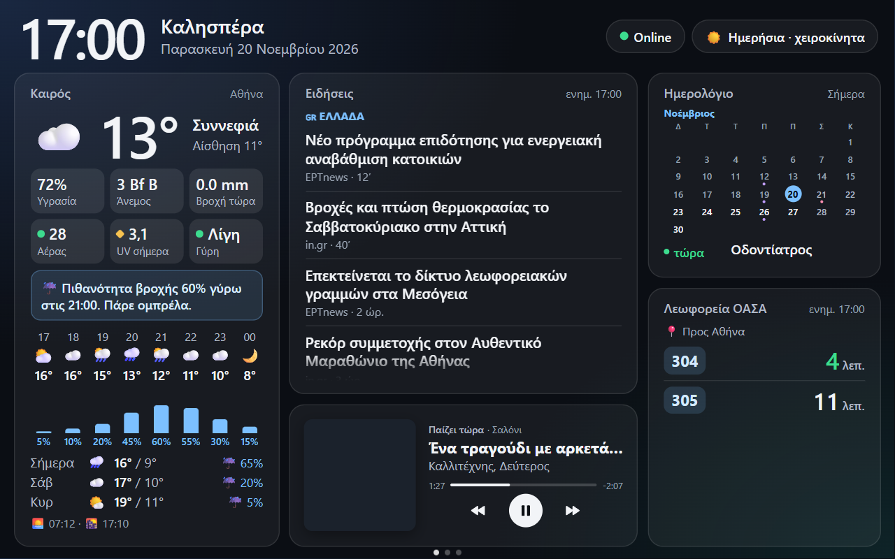
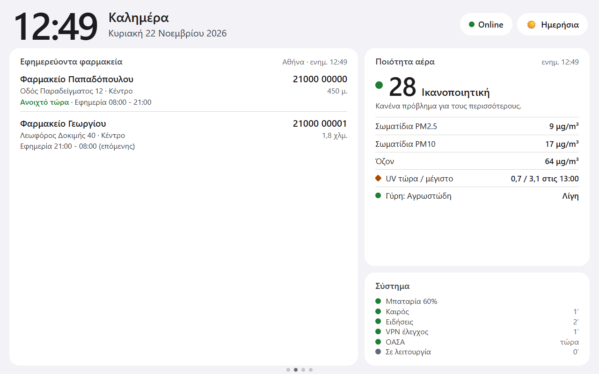
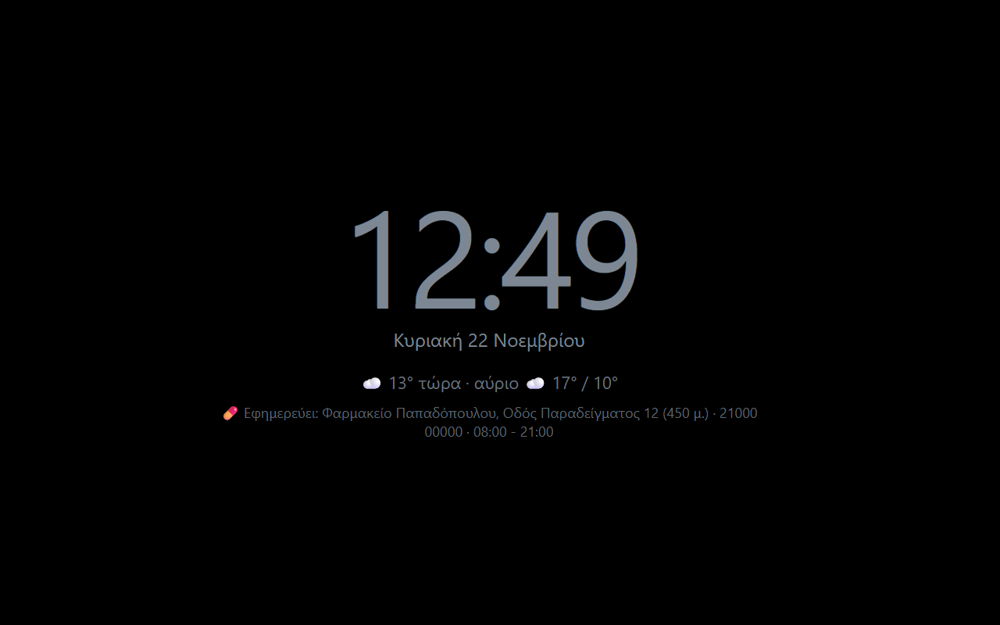

# Tablet dashboard

Ένα παλιό Android tablet γίνεται οθόνη σπιτιού: καιρός, ειδήσεις, λεωφορεία ΟΑΣΑ, ημερολόγιο, Spotify, εφημερεύοντα φαρμακεία και ποιότητα αέρα. Είναι μία σελίδα HTML που τρέχει τοπικά στο [Fully Kiosk Browser](https://www.fully-kiosk.com/), χωρίς server, χωρίς build και χωρίς συνδρομές.

Φτιάχτηκε για Huawei MediaPad T3 10 (Android 8) σε οριζόντια θέση, 1280x800. Δουλεύει σε οποιοδήποτε tablet με WebView από Chrome 100 και μετά.



## Οθόνες

| | |
| --- | --- |
|  |  |
| **Σύρσιμο αριστερά:** εφημερεύοντα φαρμακεία και ποιότητα αέρα | **Ξανά αριστερά:** ημερολόγιο μήνα και τα επόμενα γεγονότα |
|  |  |
| **Πρωί (καθημερινές 06:30 έως 09:30):** μεγάλα τα λεωφορεία | **Νύχτα:** μόνο ρολόι, καιρός και φαρμακείο που εφημερεύει |

Τα screenshots έχουν δοκιμαστικά δεδομένα.

## Τι κάνει

- **Καιρός** από [Open-Meteo](https://open-meteo.com/): τώρα, ωριαία βροχή, πρόγνωση 3 ημερών, αέρας, UV και γύρη.
- **Ειδήσεις** από RSS, με αυτόματη κύλιση. Αν πατήσεις ένα θέμα, το στέλνει στο κινητό σου μέσω Telegram.
- **Λεωφορεία ΟΑΣΑ** σε πραγματικό χρόνο, για όσες στάσεις θέλεις. Πάτημα στην κάρτα: χάρτης με τις διαδρομές και τα λεωφορεία ζωντανά.
- **Ημερολόγιο** από iCal: iCloud, Google, Outlook και ελληνικές αργίες. Μικρός μήνας στην κύρια οθόνη και μεγάλος στη δική του.
- **Spotify:** όσο παίζει μουσική, η κάρτα «Coffee corner» γίνεται «Παίζει τώρα», με κουμπιά. Τα κουμπιά θέλουν Premium.
- **Εφημερεύοντα φαρμακεία** από το vrisko.gr, ταξινομημένα κατά απόσταση.
- **Εντολές Telegram:** `refresh` ξαναφορτώνει τη σελίδα, `status` απαντά με τη θερμοκρασία και την μπαταρία.
- **Φωτογραφίες φόντου**, μία κάθε 10 λεπτά.

Ο σχεδιασμός ακολουθεί τις [Human Interface Guidelines](https://developer.apple.com/design/human-interface-guidelines/) της Apple: κείμενα που διαβάζονται από απόσταση, στόχοι αφής τουλάχιστον 44 pt, χρώμα που δεν μεταφέρει ποτέ μόνο του πληροφορία, και κίνηση που σταματά με «Μείωση κίνησης».

## Αρχεία

```
dashboard/
  dashboard.html                 σελίδα, στυλ και βασικές κάρτες (CONFIG με προεπιλογές)
  dashboard-extras.js            αέρας, φαρμακεία, οθόνες με σύρσιμο, νύχτα, εντολές Telegram
  dashboard-calendar.js          ημερολόγια iCal (με επαναλήψεις RRULE), μικρός και μεγάλος μήνας
  dashboard-spotify.js           κάρτα "Παίζει τώρα"
  dashboard-busmap.js            χάρτης λεωφορείων (Leaflet, πλακίδια Esri Dark Gray)
  dashboard-config.example.js    πρότυπο για τις προσωπικές ρυθμίσεις
tools/
  dashboard-photos-sync.ps1      φωτογραφίες σε 1280x800 και αποστολή στο tablet
  spotify-auth.mjs               σύνδεση στο Spotify μία φορά, για το refresh token
Ενημέρωση φωτογραφιών.bat        διπλό κλικ για το παραπάνω
```

## Εγκατάσταση

1. **Ρυθμίσεις.** Αντίγραψε το `dashboard/dashboard-config.example.js` ως `dashboard/dashboard-config.js` και συμπλήρωσε όσα θέλεις. Ό,τι μείνει κενό απλώς δεν εμφανίζεται. Το αρχείο αυτό είναι στο `.gitignore` και δεν ανεβαίνει ποτέ.
2. **Δοκιμή στον υπολογιστή.** Άνοιξε το `dashboard/dashboard.html` στον browser. Με `?demo=1` στο τέλος της διεύθυνσης βλέπεις δοκιμαστικά δεδομένα.
3. **Στο tablet.** Ενεργοποίησε το USB debugging και αντίγραψε τα αρχεία:
   ```
   adb push dashboard/dashboard.html dashboard/dashboard-extras.js dashboard/dashboard-calendar.js dashboard/dashboard-spotify.js dashboard/dashboard-busmap.js dashboard/dashboard-config.js /sdcard/Download/
   ```
   Αντί για adb μπορείς να τα αντιγράψεις και μέσω USB στον φάκελο Download.
4. **Fully Kiosk.** Start URL: `file:///sdcard/Download/dashboard.html`. Ενεργοποίησε Fullscreen, Keep Screen On, Launch on Boot και οριζόντιο προσανατολισμό. Η δωρεάν έκδοση αρκεί.
5. **Φωτογραφίες (προαιρετικά).** Βάλε τις εικόνες σου στον φάκελο `4K Wallpaper  Dump REUPLOAD` (ή δώσε άλλον με `-Source`) και κάνε διπλό κλικ στο `Ενημέρωση φωτογραφιών.bat`.

### Telegram
Φτιάξε ένα bot με το [@BotFather](https://t.me/BotFather), στείλε του ένα μήνυμα, και πάρε το chat id από το `https://api.telegram.org/bot<token>/getUpdates`. Τα δύο αυτά μπαίνουν στο `TELEGRAM` του config. Το tablet δέχεται εντολές μόνο από αυτό το chat.

### Spotify
1. Στο [developer.spotify.com](https://developer.spotify.com/dashboard), φτιάξε μια εφαρμογή με Redirect URI `http://127.0.0.1:8888/callback` και επιλογή **Web API**.
2. Βάλε Client ID και Client secret στο config.
3. Τρέξε:
   ```
   CLIENT_ID=... CLIENT_SECRET=... node tools/spotify-auth.mjs dashboard/dashboard-config.js
   ```
4. Άνοιξε το link που εμφανίζεται και πάτα «Συμφωνώ». Το refresh token γράφεται μόνο του στο config.

### Ημερολόγια
- **iCloud:** στο iPhone, Ημερολόγιο > (i) > Δημόσιο ημερολόγιο.
- **Google:** Ρυθμίσεις ημερολογίου > «Μυστική διεύθυνση σε μορφή iCal».
- **Outlook:** Ρυθμίσεις > Κοινόχρηστα ημερολόγια > Δημοσίευση > ICS.

Όλα δίνουν μόνο ανάγνωση. Η σελίδα τρέχει από `file://`, οπότε το WebView τα διαβάζει απευθείας, χωρίς proxy.

## Σημειώσεις

- Ό,τι βάζεις στο `dashboard-config.js` (tokens, links ημερολογίων) αποθηκεύεται ως απλό κείμενο στο tablet. Κράτα το tablet στο σπίτι και άλλαξε τα κλειδιά αν το δώσεις σε κάποιον.
- Το [fsa-efimeries.gr](https://fsa-efimeries.gr/) δεν ανοίγει σε Android 8, γιατί η αρχή πιστοποίησης που χρησιμοποιεί είναι άγνωστη σε αυτή την έκδοση. Γι' αυτό τα φαρμακεία έρχονται από το vrisko.gr.
- Τα δεδομένα ΟΑΣΑ έρχονται από το δημόσιο API του telematics.oasa.gr, ο καιρός από το Open-Meteo και οι αργίες από το δημόσιο ημερολόγιο της Google.

## Άδεια

[MIT](LICENSE): ελεύθερη χρήση, αλλαγή και διανομή, με διατήρηση της σημείωσης πνευματικών δικαιωμάτων.
