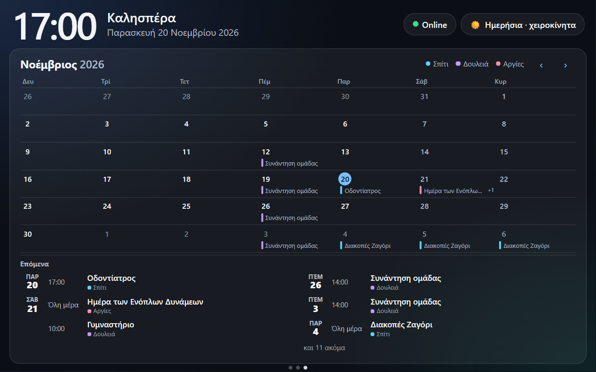
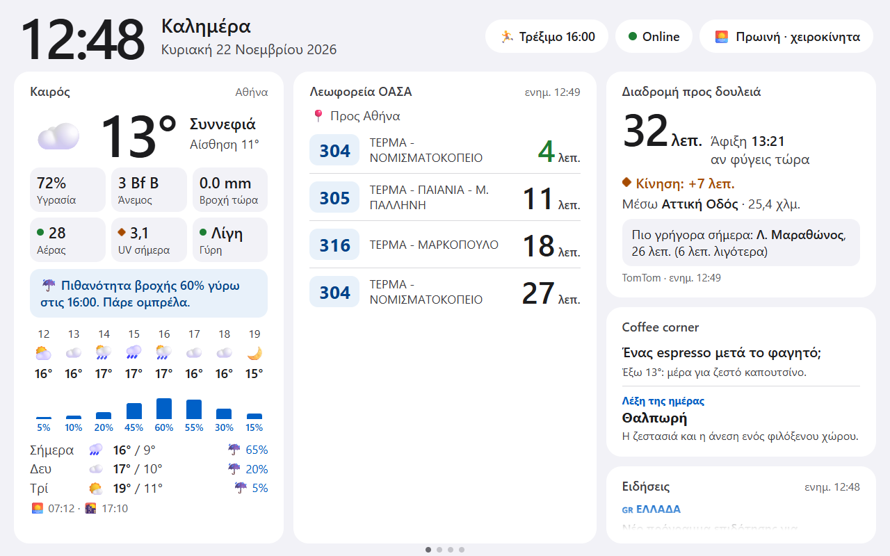

# Tablet dashboard

Ένα παλιό Android tablet γίνεται ψηφιακή κορνίζα και οθόνη σπιτιού: φωτογραφίες από iCloud, χρόνος διαδρομής, καιρός, ειδήσεις, λεωφορεία ΟΑΣΑ, ημερολόγιο, Spotify, εφημερεύοντα φαρμακεία και ποιότητα αέρα. Είναι μία σελίδα HTML που τρέχει τοπικά στο [Fully Kiosk Browser](https://www.fully-kiosk.com/), χωρίς server, χωρίς build και χωρίς συνδρομές.

Φτιάχτηκε για Huawei MediaPad T3 10 (Android 8) σε οριζόντια θέση, 1280x800. Δουλεύει σε οποιοδήποτε tablet με WebView από Chrome 100 και μετά.


## Οθόνες

| | |
| --- | --- |
|  |  |
| **Σύρσιμο αριστερά:** εφημερεύοντα φαρμακεία και ποιότητα αέρα | **Ξανά αριστερά:** ημερολόγιο μήνα και τα επόμενα γεγονότα |
|  |  |
| **Πρωί (καθημερινές 06:30 έως 09:30):** μεγάλα τα λεωφορεία, και Δευτέρα έως Τετάρτη ο χρόνος διαδρομής | **Νύχτα:** μόνο ρολόι, καιρός και φαρμακείο που εφημερεύει |

Τα screenshots έχουν δοκιμαστικά δεδομένα.

## Τι κάνει

- **Καιρός** από [Open-Meteo](https://open-meteo.com/): τώρα, ωριαία βροχή, πρόγνωση 3 ημερών, αέρας, UV και γύρη.
- **Ειδήσεις** από RSS, με αυτόματη κύλιση. Αν πατήσεις ένα θέμα, το στέλνει στο κινητό σου μέσω Telegram.
- **Λεωφορεία ΟΑΣΑ** σε πραγματικό χρόνο, για όσες στάσεις θέλεις. Πάτημα στην κάρτα: χάρτης με τις διαδρομές και τα λεωφορεία ζωντανά.
- **Ημερολόγιο** από iCal: iCloud, Google, Outlook και ελληνικές αργίες. Μικρός μήνας στην κύρια οθόνη και μεγάλος στη δική του.
- **Spotify:** όσο παίζει μουσική, η κάρτα «Coffee corner» γίνεται «Παίζει τώρα», με κουμπιά. Τα κουμπιά θέλουν Premium.
- **Εφημερεύοντα φαρμακεία** από το vrisko.gr, ταξινομημένα κατά απόσταση.
- **Εντολές Telegram:** `refresh` ξαναφορτώνει τη σελίδα, `status` απαντά με τη θερμοκρασία, την μπαταρία, τις φωτογραφίες και, το πρωί, τον χρόνο διαδρομής.
- **Ψηφιακή κορνίζα** (η προεπιλεγμένη οθόνη όλη μέρα): φωτογραφίες από κοινόχρηστο album iCloud, μία το λεπτό με απλό crossfade. Κάτω λωρίδα με ρολόι, θερμοκρασία και επόμενο γεγονός, και μόνο όταν χρειάζεται βροχή, σεισμός ή χρόνος διαδρομής. Ένα άγγιγμα δείχνει το dashboard, μετά από 3 λεπτά χωρίς άγγιγμα γυρίζει στην κορνίζα. Τις ημέρες γραφείου (Δευτέρα έως Τετάρτη 07:30-08:10) ανοίγει μόνο του το dashboard.
- **Φωτογραφίες iCloud** απευθείας από το tablet (CloudKit, όπως η σελίδα του album), χωρίς υπολογιστή. Κατεβαίνουν μία φορά, μικραίνουν σε 1280x800 και μένουν στο tablet (IndexedDB). Έλεγχος για νέες κάθε 30 λεπτά. Αν σταματήσει το link, συνεχίζει με όσες έχει και το λέει στην κάρτα Σύστημα και στο Telegram `status`.
- **Χρόνος διαδρομής** με το [TomTom Routing API](https://developer.tomtom.com/routing-api/documentation): λεπτά, ώρα άφιξης αν φύγεις τώρα, καθυστέρηση από κίνηση, κύρια διαδρομή και εναλλακτική όταν κερδίζει πάνω από 5 λεπτά. Μόνο Δευτέρα έως Τετάρτη 07:50-08:20, κάθε 3 λεπτά. Καμία κλήση εκτός παραθύρου.
- **Φωτεινό θέμα τη μέρα, σκούρο μετά τη δύση** (ώρες από το Open-Meteo).

Ο σχεδιασμός ακολουθεί τις [Human Interface Guidelines](https://developer.apple.com/design/human-interface-guidelines/) της Apple: κείμενα που διαβάζονται από απόσταση, στόχοι αφής τουλάχιστον 44 pt, χρώμα που δεν μεταφέρει ποτέ μόνο του πληροφορία, και κίνηση που σταματά με «Μείωση κίνησης».

## Αρχεία

```
dashboard/
  dashboard.html                 σελίδα, στυλ και βασικές κάρτες (CONFIG με προεπιλογές)
  dashboard-extras.js            αέρας, φαρμακεία, οθόνες με σύρσιμο, νύχτα, εντολές Telegram
  dashboard-calendar.js          ημερολόγια iCal (με επαναλήψεις RRULE), μικρός και μεγάλος μήνας
  dashboard-spotify.js           κάρτα "Παίζει τώρα"
  dashboard-busmap.js            χάρτης λεωφορείων (Leaflet, πλακίδια Esri Dark Gray)
  dashboard-outdoor.js           οθόνη 4 "Έξω": πότισμα, τρέξιμο, αεροπλάνα, σεισμοί
  dashboard-frame.js             κορνίζα, φωτογραφίες iCloud, θέμα μέρας και νύχτας
  dashboard-traffic.js           χρόνος διαδρομής (TomTom)
  dashboard-config.example.js    πρότυπο για τις προσωπικές ρυθμίσεις
  dashboard-secrets.example.js   πρότυπο για τα μυστικά (κλειδί TomTom, link του album)
tools/
  spotify-auth.mjs               σύνδεση στο Spotify μία φορά, για το refresh token
```

## Εγκατάσταση

1. **Ρυθμίσεις.** Αντίγραψε το `dashboard/dashboard-config.example.js` ως `dashboard/dashboard-config.js` και το `dashboard/dashboard-secrets.example.js` ως `dashboard/dashboard-secrets.js`, και συμπλήρωσε όσα θέλεις. Ό,τι μείνει κενό απλώς δεν εμφανίζεται. Και τα δύο είναι στο `.gitignore` και δεν ανεβαίνουν ποτέ. Ώρες, ημέρες και όρια αλλάζουν στο `CONFIG` του `dashboard.html` (FRAME, ICLOUD, TRAFFIC, THEME).
2. **Δοκιμή στον υπολογιστή.** Άνοιξε το `dashboard/dashboard.html` στον browser. Με `?demo=1` στο τέλος της διεύθυνσης βλέπεις δοκιμαστικά δεδομένα.
3. **Στο tablet.** Ενεργοποίησε το USB debugging και αντίγραψε τα αρχεία:
   ```
   adb push dashboard/dashboard.html dashboard/dashboard-extras.js dashboard/dashboard-calendar.js dashboard/dashboard-spotify.js dashboard/dashboard-busmap.js dashboard/dashboard-outdoor.js dashboard/dashboard-frame.js dashboard/dashboard-traffic.js dashboard/dashboard-config.js dashboard/dashboard-secrets.js /sdcard/Download/
   ```
   Αντί για adb μπορείς να τα αντιγράψεις και μέσω USB στον φάκελο Download.
   Το WebView κρατάει τα .js στην cache: όταν αλλάζεις ένα αρχείο, άλλαξε και το `?v=...` στις γραμμές `<script>` του `dashboard.html`.
4. **Fully Kiosk.** Start URL: `file:///sdcard/Download/dashboard.html`. Ενεργοποίησε Fullscreen, Keep Screen On, Launch on Boot και οριζόντιο προσανατολισμό. Η δωρεάν έκδοση αρκεί.
5. **Φωτογραφίες.** Στο iPhone: Φωτογραφίες > ένα κοινόχρηστο album > Άτομα > «Δημόσιο link». Το link (μορφή `https://photos.icloud.com/shared/album/...`) μπαίνει στο `ICLOUD_ALBUM_URL` του `dashboard-secrets.js`. Ό,τι προσθέτεις στο album εμφανίζεται στην κορνίζα μέσα σε 30 λεπτά.
6. **Χρόνος διαδρομής (προαιρετικά).** Δωρεάν κλειδί από το [developer.tomtom.com](https://developer.tomtom.com/) στο `TOMTOM_KEY` του `dashboard-secrets.js`, και συντεταγμένες γραφείου στο `CONFIG.WORK`.

### Telegram
Φτιάξε ένα bot με το [@BotFather](https://t.me/BotFather), στείλε του ένα μήνυμα, και πάρε το chat id από το `https://api.telegram.org/bot<token>/getUpdates`. Τα δύο αυτά μπαίνουν στο `TELEGRAM` του config. Το tablet δέχεται εντολές μόνο από αυτό το chat.

### Spotify
1. Στο [developer.spotify.com](https://developer.spotify.com/dashboard), φτιάξε μια εφαρμογή με Redirect URI `http://127.0.0.1:8888/callback` και επιλογή **Web API**.
2. Βάλε Client ID και Client secret στο config.
3. Τρέξε:
   ```
   CLIENT_ID=... CLIENT_SECRET=... node tools/spotify-auth.mjs dashboard/dashboard-config.js
   ```
4. Άνοιξε το link που εμφανίζεται και πάτα «Συμφωνώ». Το refresh token γράφεται μόνο του στο config.

### Ημερολόγια
- **iCloud:** στο iPhone, Ημερολόγιο > (i) > Δημόσιο ημερολόγιο.
- **Google:** Ρυθμίσεις ημερολογίου > «Μυστική διεύθυνση σε μορφή iCal».
- **Outlook:** Ρυθμίσεις > Κοινόχρηστα ημερολόγια > Δημοσίευση > ICS.

Όλα δίνουν μόνο ανάγνωση. Η σελίδα τρέχει από `file://`, οπότε το WebView τα διαβάζει απευθείας, χωρίς proxy.

## Σημειώσεις

- Ό,τι βάζεις στο `dashboard-config.js` και στο `dashboard-secrets.js` (tokens, links ημερολογίων, κλειδί TomTom, link του album) αποθηκεύεται ως απλό κείμενο στο tablet.
- Το δημόσιο link ενός album iCloud δείχνει σε όποιον το έχει τις φωτογραφίες, το όνομα και το email του κατόχου. Οι φωτογραφίες κρατούν και τα στοιχεία GPS. Κράτα το tablet στο σπίτι και άλλαξε τα κλειδιά αν το δώσεις σε κάποιον.
- Το [fsa-efimeries.gr](https://fsa-efimeries.gr/) δεν ανοίγει σε Android 8, γιατί η αρχή πιστοποίησης που χρησιμοποιεί είναι άγνωστη σε αυτή την έκδοση. Γι' αυτό τα φαρμακεία έρχονται από το vrisko.gr.
- Τα δεδομένα ΟΑΣΑ έρχονται από το δημόσιο API του telematics.oasa.gr, ο καιρός από το Open-Meteo, οι αργίες από το δημόσιο ημερολόγιο της Google, οι φωτογραφίες από το CloudKit της Apple (η ίδια κλήση που κάνει η σελίδα του album) και η κίνηση από το TomTom.
- Το CloudKit των κοινόχρηστων album δεν είναι επίσημα τεκμηριωμένο API. Αν η Apple το αλλάξει, η κορνίζα συνεχίζει με τις φωτογραφίες που έχει και το λέει στο Σύστημα.

## Άδεια

[MIT](LICENSE): ελεύθερη χρήση, αλλαγή και διανομή, με διατήρηση της σημείωσης πνευματικών δικαιωμάτων.
